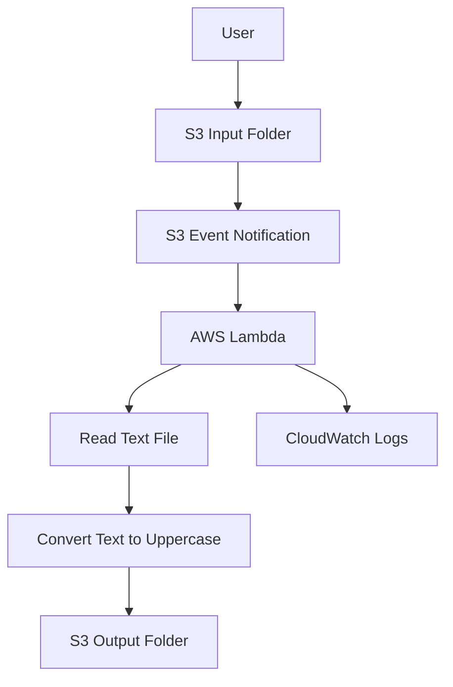

Serverless File Processing System using AWS

About the Project

I built this project to understand how serverless applications work using AWS.

The main idea is to upload a text file to an Amazon S3 bucket and automatically process it using AWS Lambda. The processed file is then stored in a separate folder in the same S3 bucket.

AWS Services Used

- Amazon S3: Stores uploaded and processed files.
- AWS Lambda: Automatically processes the uploaded file.
- IAM: Provides the required permissions to Lambda.
- CloudWatch: Helps monitor Lambda execution and logs.

How It Works

1. Upload a text file into the S3 input folder.
2. S3 triggers the Lambda function automatically.
3. Lambda reads the uploaded file.
4. The function converts the text content into uppercase.
5. The processed file is saved in the output folder.

Project Output

The uploaded text file is automatically processed, and the converted content is stored in the output folder.

What I Learned

Through this project, I gained practical experience with S3 event notifications, Lambda functions, IAM permissions and serverless architecture. I also understood how AWS services can work together without managing servers manually.

## Architecture Diagram

